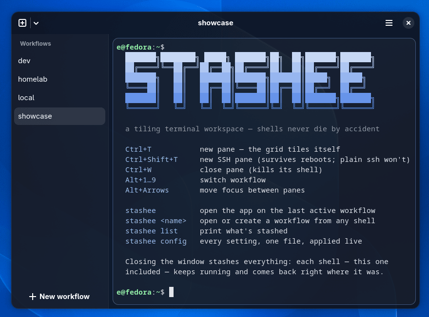

# stashee

A tiling terminal for Linux that keeps your shells running after you close it.

[](https://github.com/eeegoloauq/stashee-terminal/releases/latest)
[](https://github.com/eeegoloauq/stashee-terminal/actions/workflows/ci.yml)
[](https://aur.archlinux.org/packages/stashee)
[](LICENSE)



- Named workflows survive quitting, crashes and updates
- Panes tile automatically, no layout to manage
- SSH panes survive disconnects when the host has tmux
- Drop a file into an SSH pane to upload it
- Local voice dictation (experimental)

## Install

Fedora, via [COPR](https://copr.fedorainfracloud.org/coprs/eeegoloauq/stashee/):

```sh
sudo dnf copr enable eeegoloauq/stashee && sudo dnf install stashee
```

Arch, via the [AUR](https://aur.archlinux.org/packages/stashee): `yay -S stashee`

Needs tmux. Package files are on the [latest release](https://github.com/eeegoloauq/stashee-terminal/releases/latest).

## Usage

`stashee work` opens the "work" workflow; `stashee config` opens the config file.

[Keys and features](docs/usage.md) · [Config options](docs/config.toml.example)

## Development

[Build and test](docs/development.md) · [Contributing](CONTRIBUTING.md) · [Roadmap](ROADMAP.md)

## License

[MIT](LICENSE)
