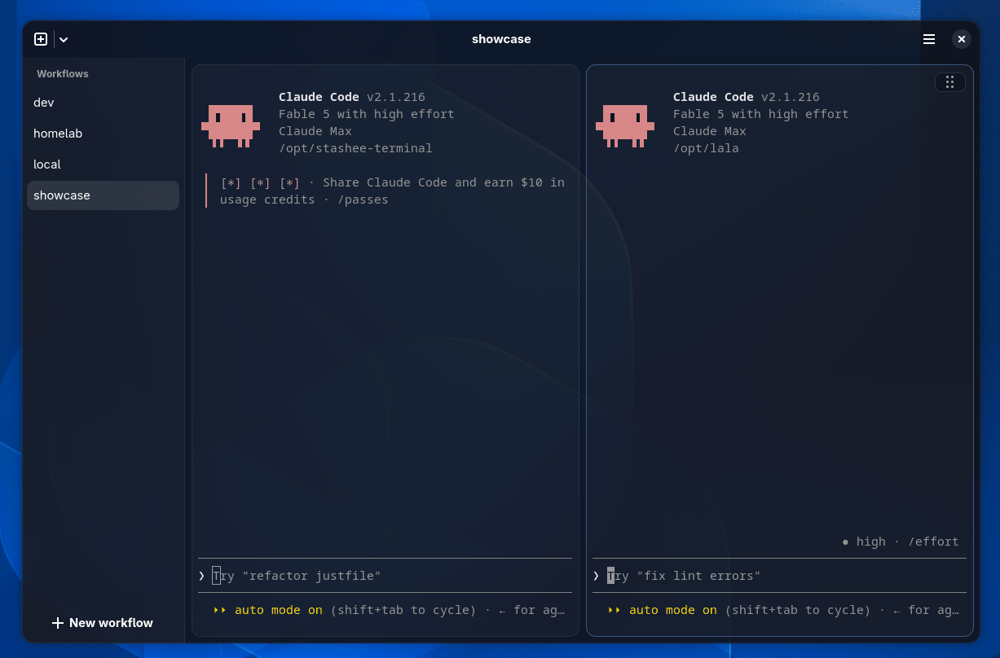
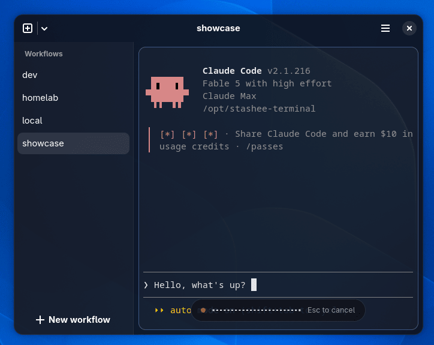

# Usage

## Keys and commands

| | |
|---|---|
| `stashee work` | open the "work" workflow from any shell |
| `Ctrl+T` | new pane |
| `Ctrl+Shift+T` | new SSH pane |
| `Alt+1…9` | switch workflow |
| `Ctrl+W` | close pane (the only way to end one) |
| `Ctrl+Shift+V` | paste; a clipboard image becomes a file path, uploaded first on SSH panes |
| `stashee config` | open the config file; changes apply live ([all options](config.toml.example)) |

There is no settings GUI and no plugin system.

## Stashing

Sessions live in tmux: quitting, crashing or updating the app loses nothing. Stashing can be
turned off per workflow for plain shells.

New panes tile automatically: up to three columns, then rows, always evenly split.

SSH panes are stashed too when the remote host has tmux: they survive local reboots and dropped
connections, and copying on the remote host fills the local clipboard. Without remote tmux the
pane is a plain SSH session.

Drop a file or paste a screenshot into an SSH pane: it is copied to the remote host with scp and
the remote path is typed at the prompt.



A coding agent per project in one stashed workflow. Closing the window leaves both running.

## Voice input (experimental)

Local dictation, off by default: set `[voice] enabled = true` in the
config, press `Ctrl+Shift+Space`, speak, press it again. The
transcript is typed into the focused pane and is not sent automatically. Recognition runs locally
on the CPU with NVIDIA's Parakeet model (25 languages). The model is a one-time download of about
670 MB, after a confirmation dialog.



## Install from a release file

Each release on the
[releases page](https://github.com/eeegoloauq/stashee-terminal/releases)
ships an `.rpm` for Fedora and a `.pkg.tar.zst` for Arch:

```sh
# Fedora
sudo dnf install ./stashee-*.rpm

# Arch
sudo pacman -U ./stashee-*.pkg.tar.zst
```

The AUR package also installs with `paru -S stashee`.

tmux is required locally, and on remote hosts for stashed SSH panes.
